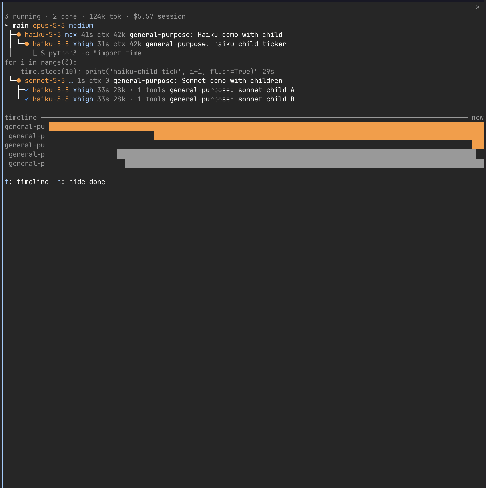

# Subagents Tree

A Claude Code mod that shows every subagent of your session in a pane docked beside the transcript.



- Agents appear as a tree, and subagents spawned by subagents are nested under their parent.
- Each row shows the model and effort, the elapsed time, and the context size or tokens spent.
- A `⎿` line under each running agent shows the tool it is running now.
- Finished agents stay in the list. Press `h` to hide them.
- A timeline shows when each agent ran. Press `t` to toggle it.
- The header shows the session's cost.
- You get a warning when two agents write the same file.
- Click a row to open that agent's transcript.

Version 0.1. The Claude Code mod API it uses is early access and may change.

## Install

At the prompt of a Claude Code terminal session:

```
/plugin install subagents-tree --marketplace kargarisaac/subagents-tree
```

Then run `/subagents`. The pane docks beside the transcript in fullscreen mode at 110 columns or wider. Narrower windows show it above the prompt.
